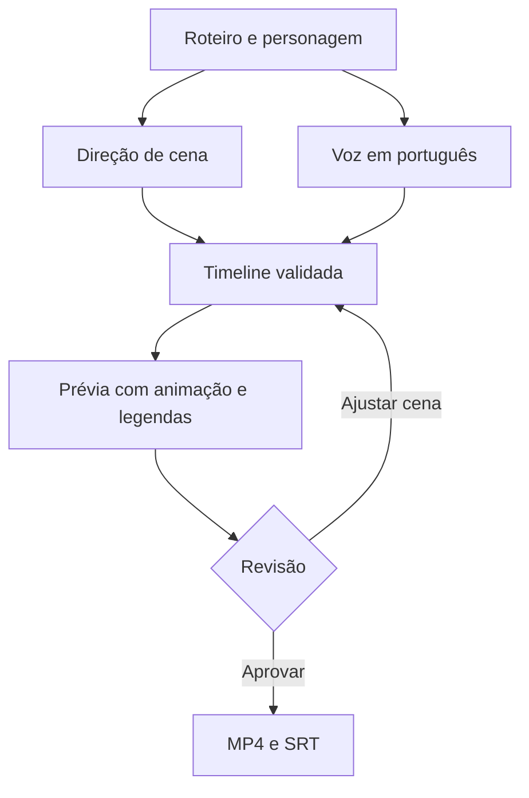

# Fábrica de Bermudas 2.0 — Plano de implementação para o Antigravity

**Ponto de partida** — Pasta vazia chamada `fábrica de bermudas 2.0`, aberta como workspace no Antigravity. Criar o projeto e o Git nessa pasta. O pacote npm usa o identificador `fabrica-de-bermudas-2`. A fábrica anterior serve de referência editorial e fornece as credenciais locais dos provedores compatíveis. A aplicação e o histórico Git da 2.0 começam na pasta nova.

**Entrega** — Você cola um roteiro em português, seleciona o Saruê e gera uma prévia. A fábrica sintetiza a voz e programa a atuação 2D, os objetos e os cortes. Você revisa e exporta MP4 vertical com legendas, além de um SRT separado.

**Escopo** — 5 sprints para o MVP. O primeiro clipe animado sai no sprint 2. O fluxo automático completo fica demonstrável no sprint 5. Um sprint adicional é opcional para ampliar personagens, vozes ou publicação.

## 1. Escopo e decisões técnicas

| Parte | Decisão de implementação |
|---|---|
| Ambiente | Aplicação local, voltada ao Dell Inspiron 5458 com Linux Mint, 8 GB de RAM e HD. Um render ativo por vez. Sem dependência de GPU para síntese visual. |
| Base | Um repositório com npm, Node.js LTS, TypeScript, tsx para os scripts locais e lockfile. Registrar em `.nvmrc` a versão instalada e verificada no sprint 1. |
| Interface | React + Vite. Uma tela para roteiro, personagem e prévia, com lista de cenas para revisão. |
| Serviço local | Express em loopback. Validação de JSON com Zod, persistência em arquivos locais por projeto e fila com concorrência 1. Vitest para testes. |
| Animação | Saruê desenhado em camadas SVG e controlado pelo código. Remotion renderiza quadros, movimentos e legendas. FFmpeg e ffprobe verificam e montam o MP4. |
| Voz | Uma voz PT-BR consistente. Testar Piper como primeira opção local. Se a voz ou o desempenho do Piper não passar no piloto, conectar um provedor TTS já disponível por configuração explícita. |
| Direção | Um provedor de texto configurável, com resposta em JSON e catálogo de ações. Uma direção determinística local serve para testes e rascunhos quando a rede estiver indisponível. |
| Saída | Prévia de 360 × 640 e final de 720 × 1280, ambos a 24 fps. MP4 H.264/AAC, legenda queimada uma vez e arquivo SRT opcional para download. |

O Antigravity é onde o projeto será desenvolvido. A aplicação 2.0 reaproveita as chaves salvas na instalação antiga. A conta usada para programar é separada das credenciais dos provedores da aplicação.

### Reaproveitar a configuração da fábrica antiga

O repositório antigo carrega `config.toml` da raiz da instalação e ignora esse arquivo no Git. A 2.0 deve ler o arquivo **local** em modo somente leitura. O `config.example.toml` público serve para conferir o formato dos campos.

- **Localização.** Procurar apenas nas pastas irmãs com os nomes `geradordevideos`, `fabrica de bermudas` ou `fábrica de bermudas`. Se houver um único `config.toml`, usar esse caminho. Se houver vários ou a instalação estiver em outro lugar, rodar `npm run config:link -- "/caminho/para/a/fabrica-antiga/config.toml"` uma vez. O comando salva só o caminho em `storage/local-settings.json`, fora do Git. Um vínculo explícito tem prioridade sobre a detecção automática.
- **Mapeamento.** Ler `[app].llm_provider` como preferência do projeto antigo quando houver um adaptador correspondente. Para direção, o exemplo antigo tem `[app].gemini_api_key`, `[app].groq_api_key`, `[app].openrouter_api_key` e `[app].openai_api_key`, além dos campos de modelo correspondentes. Para voz externa, `[minimax_tts].api_key` e `[elevenlabs].api_key` são campos previstos. No MVP, integrar um diretor compatível com a configuração disponível e ligar TTS externo apenas se ele for escolhido em vez do Piper.
- **Precedência.** Uma variável explícita de servidor da 2.0 prevalece sobre o campo legado equivalente. Documentar em `.env.example` apenas os nomes das variáveis dos adaptadores implementados, seguindo `DIRECTOR_PROVIDER`, `DIRECTOR_MODEL`, `TTS_PROVIDER` e o nome específico da chave, como `GEMINI_API_KEY` ou `MINIMAX_API_KEY`. Considerar valores vazios como ausentes. Ler só campos permitidos dos adaptadores implementados. Se a preferência antiga for de um provedor ainda sem adaptador, indicar isso no diagnóstico e permitir selecionar outro.
- **Tratamento das chaves.** Resolver os valores apenas no servidor e em memória. Nenhuma chave vai para o navegador, para o JSON do projeto, para mensagens de erro, para o Git ou para o chat do Antigravity. Não copiar o `config.toml` para a 2.0. O parser e os clientes de API devem apresentar erros resumidos sem incluir o conteúdo bruto do arquivo ou cabeçalhos de autenticação. Usar a chave apenas no adaptador do provedor ao qual ela pertence.
- **Diagnóstico.** O `doctor` informa o provedor e se há configuração, se falta o arquivo, se ele está ilegível ou se o provedor escolhido ainda não é suportado. A checagem é local. O teste de integração de cada provedor escolhido verifica depois se a chave funciona. A falta do arquivo mantém disponível o piloto local.

Referências do formato legado. [Configuração de exemplo](https://github.com/lucaaregis4r-ops/geradordevideos/blob/main/config.example.toml) e [arquivos ignorados no Git](https://github.com/lucaaregis4r-ops/geradordevideos/blob/main/.gitignore).

**MVP** — Um Saruê, uma voz, um personagem por vídeo, episódio alvo de 60–90 s, revisão por cena e exportação manual. O teste completo usa oito cenas. O projeto aceita texto corrido, sem exigir marcações. Uma indicação visual opcional pode ser aplicada na revisão de cena.

**Segunda rodada** — Segundo personagem, múltiplas vozes por episódio, sincronização fonética avançada, 1080p, lote e publicação automática aprovada ficam fora dos cinco sprints. Nenhum deles é dependência para produzir o primeiro Short.

Referências de produto. [Ficha do Saruê](https://chatgpt.com/library?file_id=libfile_233c5f6e8c14819199f4d8e4fc80548c&account_id=personal) e [plano da fábrica editorial](https://chatgpt.com/library?file_id=libfile_2b01eda4840c8191b58ebbf97ffce7f6&account_id=personal).

## 2. Fluxo e contratos

| Contrato | Campos e regra |
|---|---|
| `ScriptRevision` | `revisionId`, `canonicalText`, `narrationHash`, `characterId`. Normalizar apenas quebras de linha antes de mostrar o texto que será aprovado. Depois disso, preservar palavras, acentos, pontuação e ordem. |
| `ScenePlan` | `schemaVersion`, `scriptRevisionId`, `rigVersion`, `scenes`. Cada cena tem `sceneId`, `startChar`, `endChar` e uma lista ordenada de planos. Os intervalos têm início inclusivo e fim exclusivo e seguem os índices UTF-16 do JavaScript. Validar que a concatenação das fatias recupera exatamente o texto canônico, com cortes em limites de parágrafo ou frase e sem dividir um caractere Unicode composto. |
| `Shot` | `shotId`, `setId`, `camera`, `startAnchor`, `actions`. Cada ação identifica um movimento registrado no rig, o objeto quando necessário e uma âncora de texto da cena. O primeiro plano começa no quadro zero. |
| `VoiceTake` | `sceneId`, `audioPath`, `durationMs`, `voiceKey`, `timingLevel` e `marks`. Cada marca informa intervalo no texto original e intervalo em milissegundos no áudio. O áudio é medido depois da síntese e da preparação. |
| `SceneTimeline` | `sceneId`, `fps`, `frameCount`, `shots`, `actions`, `mouthCues` e `captions`. É o único contrato de entrada do renderizador. Há uma faixa de voz por cena, mesmo quando a imagem corta várias vezes. |
| `ProjectRevision` | `revisionId`, referências do roteiro, rig, voz e cenas, `status` e `approvedRevisionId`. Alterar fala, voz, personagem ou cena invalida a aprovação daquela versão. |

**Exemplo de direção** — A fala “Aí coloquei um cronômetro de dez minutos.” já existe no roteiro. O diretor devolve a ação `show_prop` com alvo `timer` e âncora “cronômetro”, referenciada pelo intervalo da ocorrência no texto. O compilador traduz a âncora em quadro usando o tempo da voz. Se houver apenas marcas de frase, posiciona o evento no início da frase e indica na revisão que o tempo é aproximado.

O diretor recebe as opções disponíveis e só devolve decisões visuais. A fala vem diretamente do roteiro, nunca da resposta da IA. Rejeitar IDs desconhecidos, ações incompatíveis no mesmo membro, intervalos quebrados ou âncoras fora da cena. Usar gesto local simples como fallback identificado e oferecer nova tentativa.

**Voz e sincronismo** — Sintetizar por cena falada quando o TTS fornecer marcas utilizáveis. Com Piper ou outro TTS sem timestamps, sintetizar em blocos curtos de frase, medir cada bloco e concatenar uma faixa única por cena. Quebras de legenda seguem esses blocos. Correções de pronúncia alteram o texto enviado ao sintetizador e preservam a fala escrita na legenda. Usar detecção de energia de áudio para boca aberta e fechada, mantendo-a fechada nas pausas. Converter os cortes para quadros a partir dos tempos acumulados, com cobertura do áudio até seu último trecho. Exibir precisão por frase ou palavra na revisão.

**Execução e dados** — Rodar processos externos por lista de argumentos para aceitar caminhos com espaços e acentos. Guardar trabalhos em `storage/projects/<id>/`, ignorado pelo Git. Identificar arquivos por revisão, gravar resultados de forma atômica, reaproveitar clipes concluídos e descartar apenas temporários. Uma interrupção deve deixar o trabalho como retomável e não criar um MP4 disponível para download. O cache de voz depende da fala, da pronúncia e do perfil de voz. O visual depende do rig, da timeline, da boca e do preset. Refazer um gesto reaproveita a voz e os clipes das outras cenas.

## 3. Arquivos e comandos

| Caminho | Responsabilidade |
|---|---|
| `src/shared/contracts.ts` | Schemas versionados usados por frontend, API e renderizador. |
| `src/server/config.ts`, `scripts/link-legacy-config.ts` | Resolver o caminho legado, ler os campos permitidos no servidor e registrar o vínculo local. |
| `src/server/index.ts`, `src/server/jobs.ts` | API local, estados e fila de um trabalho, com progresso, retomada e erro por etapa. |
| `src/server/script.ts`, `src/server/director.ts` | Congelar roteiro, verificar fatias literais, dirigir com o catálogo e validar a resposta. |
| `src/server/voice.ts`, `src/server/timeline.ts` | Gerar e medir áudio, mapear âncoras, boca e legendas. |
| `src/server/render.ts` | Isolar os processos de render, cache, verificação com ffprobe e montagem final. |
| `src/video/Root.tsx`, `src/video/Scene.tsx` | Registrar as composições e animar o rig por quadro. |
| `assets/characters/sarue/rig.json` e SVGs | Personagem em camadas, pontos de articulação, expressões e ações. |
| `src/web/App.tsx` | Formulário, prévia e revisão por cena. |
| `tests/fixtures/`, `tests/` | Roteiros, plano manual, amostras de voz e testes. |
| `README.md`, `AGENTS.md` | Instalação e comandos de uso, regras de roteiro e instruções para continuar no Antigravity. |

Criar os comandos abaixo no `package.json` à medida que cada sprint os entregar.

| Comando | O que comprova |
|---|---|
| `npm run doctor` | Node, FFmpeg, ffprobe, pasta gravável, render local e status da configuração de voz e direção, sem exibir valores. |
| `npm run config:link -- "/caminho/para/config.toml"` | Vincula a configuração local da fábrica antiga pelo caminho. |
| `npm run dev` | Abre frontend e servidor local. |
| `npm test` e `npm run typecheck` | Testes determinísticos e checagem TypeScript. Os testes padrão rodam sem contas externas. |
| `npm run demo:pilot` | Gera a demonstração curta com a fixture do sprint 2. No sprint 3 ganha opção de síntese real. |
| `npm run demo:episode` | Gera o roteiro completo, com modo de teste local e modo de integração com os provedores configurados. |

## 4. Cinco sprints obrigatórios

| Sprint | Entrega principal | Critério de passagem |
|---|---|---|
| 1. Fundação | Workspace, ferramentas, vínculo local e primeiro render de diagnóstico | Um clone limpo instala com `npm ci`, abre com `npm run dev` e gera um MP4 de teste. O `doctor` informa se a configuração antiga foi encontrada. |
| 2. Saruê em movimento | Rig e piloto de cerca de 15–20 s com plano manual e áudio de teste | Saruê pega o celular, reage ao cronômetro e muda de enquadramento. |
| 3. Voz e sincronização | Fala PT-BR, legendas, boca e timeline com áudio real | O piloto usa voz sintetizada, a fala aparece uma vez e a última sílaba está inteira. |
| 4. Direção automática | Roteiro cru vira plano visual validado, com voz e prévia | O mesmo piloto funciona sem plano manual quando o provedor está configurado. |
| 5. Estúdio e exportação | Revisão por cena, render final e Short de 60–90 s | Um roteiro novo gera prévia, aceita ajuste localizado e exporta MP4/SRT após aprovação. |

### Sprint 1 — Fundação local

- [ ] Inicializar Git e npm na pasta aberta. Criar React/Vite, servidor Express, TypeScript, lockfile, Vitest, `.gitignore` e `.env.example`. Conectar Vite à API local e expor `GET /api/health`.
- [ ] Criar `npm run doctor`. Verificar Node, FFmpeg, ffprobe, gravação em storage, navegador de render e status da configuração antiga. Reportar ferramenta ausente pelo nome e orientar a correção no README.
- [ ] Implementar `npm run config:link` e a descoberta restrita de `config.toml`. Usar um parser TOML e limitar a leitura aos campos de provedores suportados. Em `tests/config.test.ts`, testar com chaves fictícias a detecção, a prioridade do vínculo e da variável explícita, arquivo ausente ou inválido, caminhos com espaços e ausência dos valores em logs e no arquivo de vínculo.
- [ ] Renderizar um cartão de dois segundos usando Remotion e inspecionar o arquivo com ffprobe. Usar a pasta com o nome real, incluindo espaços e acentos.
- [ ] Rodar `npm ci`, `npm test`, `npm run typecheck` e `npm run doctor`. Registrar no README as versões efetivamente testadas.

### Sprint 2 — Rig e piloto manual

- [ ] Construir a partir da ficha do Saruê dois enquadramentos do boneco, plano médio e close. Separar cabeça, olhos, sobrancelhas, boca, tronco, braços, mãos e cauda. Fixar boné, óculos e correntes nas camadas adequadas.
- [ ] Cadastrar `idle`, `blink`, `raise_brow`, `pick_up_phone`, `put_down_phone`, `show_prop` e `point`. Preparar celular, mesa e cronômetro. Definir poses de repouso para que o personagem não salte entre gestos.
- [ ] Criar as duas cenas do piloto com plano manual, amostra de voz de teste e troca de plano dentro da primeira cena. Renderizar em sequência com `npm run demo:pilot`.
- [ ] Verificar quadros antes e depois de pegar o celular e de mostrar o cronômetro. Assistir ao clipe e medir tempo, memória e temporários no Dell como referência. Se o clipe de teste precisar de ajuste de duração, mexer na marcação ou no ritmo, mantendo a fala.

### Sprint 3 — Voz, boca e legendas

- [ ] Implementar o adaptador `synthesize(text, voiceProfile)` em `src/server/voice.ts`. Gerar amostra em PT-BR com Piper, registrando voz, licença e como instalar o modelo. Se essa opção falhar na avaliação de clareza ou viabilidade no Dell, escolher um TTS externo disponível e resolver a chave pelo vínculo do sprint 1. Testar uma amostra sem mostrar a credencial.
- [ ] Implementar `compileTimeline(plan, voiceTake, fps)` com duração medida por ffprobe, tempos por frase ou palavra e boca guiada pela fala. Implementar geração de SRT a partir da mesma timeline.
- [ ] Em `tests/timeline.test.ts`, cobrir uma fala em dois planos, pausa com boca fechada, pronúncia diferente da grafia, último frame e erro de áudio ausente.
- [ ] Regerar o piloto com voz sintetizada e verificar em escuta que a fala não se repete nem é cortada. No MVP, a boca precisa reagir à voz e fechar nas pausas. Formas fonéticas mais detalhadas entram depois.

### Sprint 4 — Direção automática e trabalho retomável

- [ ] Implementar `planScenes(script, rig, provider)` com resposta declarativa e validação do catálogo. Usar as fatias do texto aprovado para criar a narração. O provedor recebe o catálogo de cenas, movimentos e objetos.
- [ ] Conectar um provedor de texto compatível com a configuração antiga e usar a chave pelo vínculo do sprint 1. Testar a chamada com o roteiro curto e distinguir configuração ausente de autenticação rejeitada. Limitar a uma chamada de direção e uma tentativa de reparo por revisão. Sem conexão ou resposta válida, produzir storyboard local identificado ou exibir a causa com opção de repetir.
- [ ] Ampliar o catálogo para a sala com sofá, detalhe de quadra, caderno, expressão de cansaço e gesto de guardar o celular. Encadear os estágios com `jobs.ts`, salvando cada resultado concluído.
- [ ] Em `tests/director.test.ts`, cobrir literalidade com acentos e emoji, âncora fora da fala, gesto inexistente e resposta inválida do provedor. Em `tests/jobs.test.ts`, simular interrupção, retomada e alteração de gesto com cache de voz preservado.
- [ ] Rodar o piloto em modo automático com o provedor configurado. Conferir que ações distintas foram aplicadas com relação clara com a fala. Exercitar o mesmo caminho com provedor simulado para reproduzir o teste sem custo.

### Sprint 5 — Estúdio e Short completo

- [ ] Ligar formulário e prévia à API. Usar `POST /api/projects`, `POST /api/projects/:id/generate` e `GET /api/projects/:id` para criação, início e status. Em revisão, permitir alterar direção por cena, refazer a voz, aprovar a revisão exibida e exportar essa revisão.
- [ ] Mostrar andamento e erros em linguagem clara. A edição visual refaz a cena afetada. Alteração de voz recalcula o tempo e o sincronismo das cenas que usam a voz modificada. Vincular cada prévia à sua revisão e manter a última prévia visível até a nova ficar pronta.
- [ ] Exportar em 720 × 1280 a 24 fps. Verificar resolução, FPS, faixas de áudio e vídeo, duração, legibilidade e última fala. Impedir exportação final quando houver cena incompleta ou aprovação de outra revisão. Confirmar que a legenda queimada e o SRT usam a mesma timeline. Em 720 × 1280, usar as margens editoriais de 40 px de cada lado, 167 px no topo e 233 px na base, conferidas na prévia.
- [ ] Rodar `npm run demo:episode` com o roteiro abaixo e fazer a mesma operação pela interface. Repetir com um segundo roteiro de pelo menos três parágrafos para verificar que a direção não foi codificada para a demonstração.
- [ ] No Dell, registrar duração do render completo, pico de RAM, espaço temporário e tempo para refazer uma cena. Se o preset final ficar pesado, testar concorrência 1 e otimização do rig e dos clipes antes de alterar o formato final. Assistir ao Short no celular e corrigir o que sair da área segura ou da fala.

## 5. Roteiro de teste — “Quando foi que descansar virou atraso?”

Exemplo criado para o plano. Os intervalos finais vêm da voz, e as ações da tabela ilustram o que a direção automática deve produzir. No teste principal, a entrada será só a coluna de fala, com um parágrafo por cena e o Saruê selecionado. No teste de revisão, trocar uma ação e confirmar que o áudio é reaproveitado.

| Cena | Fala que entra no roteiro | Decisão esperada da fábrica |
|---|---|---|
| 1 | Eu sentei no sofá pra descansar. Em menos de um minuto, já tava me perguntando se eu não devia estar fazendo outra coisa. | Saruê relaxa. Na segunda frase, inclina a cabeça e olha para a mesa. |
| 2 | Peguei o celular pra olhar a hora. Quando vi, eu tava respondendo mensagem que podia esperar até amanhã. | Mão pega o celular. Corte para a tela com ícones, sem inventar mensagens. |
| 3 | Aí coloquei um cronômetro de dez minutos. Até pra parar eu inventei um jeito de me fiscalizar. | Cronômetro aparece na palavra “cronômetro”. Close na sobrancelha quando ele percebe a contradição. |
| 4 | E a cabeça já tava na terça-feira, no treino que faltava e na mensagem que eu ainda precisava mandar. | Caderno abre na mesa. Surgem três marcas simples, seguindo a ordem da fala. |
| 5 | O engraçado é que ninguém tinha me cobrado nada naquele momento. Eu já tinha sentado no sofá com a cobrança junto. | Volta ao plano médio. Saruê encara a câmera e deixa o celular sobre a mesa. |
| 6 | Outro dia eu fui ver um jogo com um amigo. A gente ficou dez minutos sem falar de trabalho. Nem percebi. | O quadro abre com um detalhe de quadra. Saruê relaxa os ombros e sorri. |
| 7 | Quando cheguei em casa, deixei o celular longe do sofá. Fiquei ali um tempo, ouvindo o barulho da rua. | Guarda o celular. Câmera segura o quadro por uma pausa curta. |
| 8 | Hoje eu ainda pego o celular sem pensar. Às vezes eu percebo, largo de novo e fico mais um pouco. | A mão começa a ir até a mesa e recua. Corta depois da última fala. |

Usar as cenas 2 e 3 em sequência no piloto. Guardar o texto em `tests/fixtures/pilot.txt` e o roteiro completo em `tests/fixtures/episode.txt`. Na demonstração do episódio completo, conferir se cada mudança visual acompanha o que o Saruê está dizendo. Um clipe com os mesmos gestos em todas as cenas não passa na revisão editorial.

## 6. Instrução para abrir o primeiro sprint no Antigravity

Copie este plano para a raiz da pasta `fábrica de bermudas 2.0`. Abra essa pasta como projeto e envie a instrução abaixo.

> Leia `Plano_Fabrica_de_Bermudas_2_0.md` e implemente somente o Sprint 1 na pasta aberta. Inicialize o projeto nesta pasta, com npm e Git. Use o plano como referência de escopo. Entregue a aplicação inicial, os diagnósticos, o vínculo com o config.toml local da fábrica antiga e o MP4 de dois segundos. Procure o arquivo apenas nos caminhos definidos no plano. Se ele não aparecer, deixe o comando de vínculo pronto e indique no README onde informar o caminho. Registre só o status da configuração, sem revelar valores. Ao terminar, registre os comandos executados, o caminho do MP4 e qualquer bloqueio no README. Passe ao próximo sprint somente depois de verificar os critérios do Sprint 1.

Em cada sprint seguinte, use a mesma instrução com o número correspondente e peça a demonstração da tabela. Um sprint termina pelo resultado reproduzível, não pelo volume de código. Os cinco sprints são uma divisão do trabalho, sem compromisso prévio de duração. As incertezas que mais afetam o tempo são preparar o rig do Saruê, aprovar a voz e medir o render no Dell.
